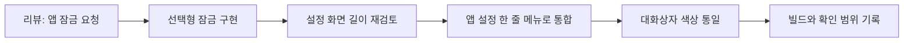

# 리뷰에서 시작한 앱 잠금 개선 · 3.5 업데이트 준비

2026-10-13 · [개선 기록 목차](README.md) · [공식 홈페이지](https://tradingnote.kr/)

## 사용자의 한마디를 다음 작업으로

앱을 처음 사용한 분이 잠금 기능이 있으면 좋겠다는 리뷰를 남겨 주셨습니다. 투자 금액과 개인 메모가 쌓이는 기록 앱에서, 다른 사람이 휴대전화를 잠시 보더라도 기록을 바로 열어 보지 못하도록 하는 기능은 필요하다고 판단했습니다.

리뷰에는 1~2일 내 업데이트를 준비하겠다고 답변할 문안을 작성하고, 기존 거래·통계 기능에 손대지 않는 범위로 앱 잠금을 구현했습니다. 이 문서는 구현과 확인 결과의 기록이며, 스토어 심사나 배포 완료를 뜻하지 않습니다.

리뷰 작성자 이름·프로필·정확한 기기 정보는 싣지 않았습니다. 아래 리뷰 내용은 원문 인용이 아닌 요약입니다.

| 피드백 | 판단 | 이번 처리 |
|---|---|---|
| 처음 사용해 보니 앱 잠금이 있으면 좋겠다 | 투자 기록을 보호하는 접근 제어가 필요 | 설정에 선택형 앱 잠금 추가 |
| 현재가·배당률을 자동으로 받아 계산해 주는 기능이 아쉽다 | 기록 중심 앱에 대한 기대와 정보 연동 요구를 구분할 필요 | 개선 방향 검토. 이번 작업에서 시세·배당 자동 연동은 구현하지 않음 |

## 1. 기능 범위를 먼저 정하기

이번 변경의 중심은 **기기 인증을 통과한 뒤 기록을 볼 수 있게 하는 것**입니다.

- 앱 잠금은 기본 꺼짐으로 제공
- 잠금을 켜거나 끌 때 기기 인증 확인
- 지원 기기의 지문 등 생체 인증 또는 기기 PIN·패턴·비밀번호 사용
- 앱을 벗어난 뒤 재잠금 시간을 즉시·1분·5분으로 선택
- 잠금 사용 중 스크린샷과 최근 앱 미리보기 차단
- 잠금 화면을 표시할 때 작성 중인 화면 상태를 유지하도록 구성

앱 잠금은 내보낸 백업 파일을 암호화하는 기능과 다릅니다. 이 차이는 설정 설명에도 안내했습니다. 거래 계산이나 보고서 로직은 이번 변경 범위에 넣지 않았습니다.

## 2. 첫 구현 후 다시 다듬은 설정 화면

처음에는 앱 설정 아래에 별도 ‘보안’ 구역을 만들고 스위치와 재잠금 시간 선택을 펼쳐 두었습니다. 기능은 찾기 쉬웠지만 설정 화면이 길어졌습니다.

다시 화면을 살펴보고, 기존 설정의 흐름에 맞게 **‘앱 설정’ 안의 한 줄 메뉴**로 바꿨습니다. 종목 색상 아래에 앱 잠금을 배치하고, 눌렀을 때만 세부 설정 창을 열도록 정리했습니다.

| 단계 | 화면 구성 | 바꾼 이유 |
|---|---|---|
| 첫 구현 | 별도 보안 구역 + 항상 보이는 잠금 옵션 | 기능을 먼저 연결하고 확인 |
| 메뉴 정리 | 앱 설정 안의 앱 잠금 한 줄 + 세부 설정 창 | 설정 화면의 세로 길이를 줄이고 기존 흐름에 통합 |
| 시각적 마무리 | 다른 설정과 같은 배경·둥근 모서리 | 기본 대화상자의 보라색 느낌을 줄이고 디자인 통일 |

밝은 테마에서는 다른 설정 창과 같은 흰색 계열 배경을 사용하고, 다크 테마에서는 앱의 테마 색상을 따르도록 했습니다. 색상 변경 때문에 잠금 동작까지 바꾸지는 않았습니다.



## 3. 공개용 코드: 화면 구성만 짧게

아래 코드는 실제 변경 방향을 설명하기 위한 **축약 예시**입니다. 앱 원본 전체 diff나 독립 실행 가능한 예제가 아닙니다. 인증 처리와 상태 관리 구현은 공개하지 않습니다.

### 펼쳐 둔 옵션을 필요할 때만 표시하기

```kotlin
// 변경 전: 설정 목록 안에 세부 옵션을 항상 표시
Column {
    LockToggle()
    LockDelayOptions()
}

// 변경 후: 한 줄 메뉴를 누르면 세부 옵션 표시
SettingsRow(onClick = { showOptions = true })
if (showOptions) {
    LockOptionsDialog()
}
```

### 기존 설정 창과 배경 맞추기

```kotlin
// 설명용 일부 인자: 생략된 내용과 이벤트 처리는 별도
AlertDialog(
    containerColor = MaterialTheme.colorScheme.surface,
    tonalElevation = 0.dp,
    shape = RoundedCornerShape(24.dp),
    // ...
)
```

중요했던 점은 새 기능만 눈에 띄게 만드는 것이 아니라, 원래 앱 안에 자연스럽게 들어가도록 반복해서 정리하는 것이었습니다.

## 4. 확인 결과와 남은 확인

| 확인 항목 | 결과와 범위 |
|---|---|
| 재잠금 시간 정책 테스트 | 6개 통과. 시간 경계를 검사하며 생체 인증 실행 테스트는 아님 |
| 기존 단위 테스트 | 9개 통과 |
| 앱 잠금 추가 시점 | 디버그·릴리스 빌드 통과 |
| 메뉴 이동·배경 변경 후 | 디버그 빌드 통과 |
| 에뮬레이터 | 잠금 추가 최종본 설치·시작 확인, 확인 시점의 치명적 오류 로그 없음 |
| 실제 기기 인증 | 지문·PIN 성공과 취소, 앱 재진입 흐름은 배포 전 추가 확인 필요 |

마지막 배경 변경을 빌드할 때 한 번 APK 패키징 단계에서 실패했고, 재실행에서는 성공했습니다. 이를 인증 로직 오류로 단정하지 않았으며, 성공한 결과와 실패했던 단계 모두 기록했습니다.

‘테스트 15개 통과’와 ‘모든 기기에서 잠금 검증 완료’는 다른 말입니다. 특히 이번 자동 테스트가 확인한 것은 재잠금 시간 정책과 기존 계산 사례입니다. 실제 인증 흐름까지 확인했다고 확대해서 쓰지 않겠습니다.

변경 전 파일은 개인 작업 공간에 백업했습니다. 이 저장소에는 해당 원본 백업이나 앱 전체 코드를 올리지 않았습니다.

## 5. 다음 리뷰도 같은 방식으로

현재가·배당 정보 요청은 별도 과제로 남겼습니다. 자동 정보 연동은 데이터 제공 범위와 운영 부담까지 검토해야 하므로, 앱 잠금 업데이트에 한꺼번에 섞지 않았습니다.

이번에 다시 배운 점은 세 가지입니다.

1. 리뷰를 기능 목록으로만 옮기지 않고, 기존 사용 흐름 안에서 어디에 들어갈지 판단하기
2. 첫 구현 뒤에도 화면의 길이와 색상을 다시 확인하고 다듬기
3. AI 코딩 도구의 도움을 받더라도 변경 범위와 검증 결과를 직접 확인하고 관리하기

주식매매노트를 계속 운영하면서, 사용자가 남긴 의견을 작은 개선으로 연결하고 그 과정을 기록해 나가겠습니다.

---

공개 범위: 익명으로 요약한 리뷰, 구현 과정, 검증 범위, 화면 구성 예시. 내부 인증·잠금 상태 처리 코드, 저장 키, DB 구조, 개인 거래 데이터, 서명·인증 정보, 개인 학습용 전체 코드 PDF는 포함하지 않았습니다.
