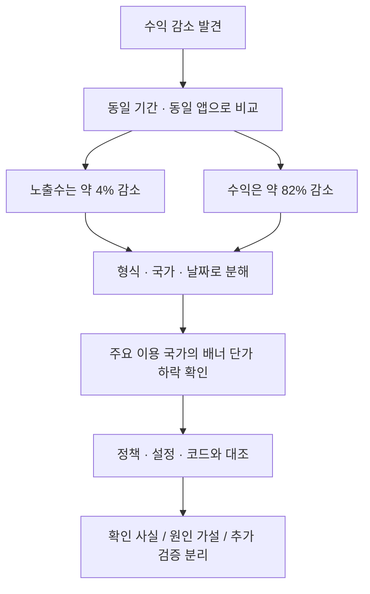

# 운영 기록 01 · 노출은 비슷한데 광고 수익이 줄었을 때

> 2026-10-16 · 주식매매노트 운영 분석  
> 실제 운영 데이터를 직접 조회하고 AI 도구로 교차 검토한 과정을 공개 범위에 맞게 요약했습니다.  
> 금액, 원본 노출·클릭 횟수, 실제 eCPM, 광고·계정 식별자, 비공개 보고서는 공개하지 않습니다. 변화율은 반올림한 값입니다.

## 1. 문제를 어떻게 발견했나

앱을 운영하면서 이번 달 광고 수익이 이전보다 크게 줄어든 것을 확인했습니다. 광고 노출은 크게 달라 보이지 않아, 처음에는 광고 표시 오류인지 광고 시장의 변화인지 구분하기 어려웠습니다.

최근에는 사용자 리뷰를 바탕으로 거래 편집 화면, 투자 가이드, 앱 잠금 등을 개선했습니다. 수익 변화가 업데이트 때문인지 의심할 수 있는 상황이었지만, 시점이 가깝다는 이유만으로 코드를 다시 수정하기보다 먼저 지표를 분해했습니다.

이번 작업의 목표는 수익을 바로 끌어올리는 변경이 아니라 **어디에서 감소했는지 확인하고, 확인된 사실과 원인 가설을 분리하는 것**이었습니다.

## 2. 비교 조건부터 맞췄다

월 전체와 진행 중인 이번 달을 비교하면 기간 차이만으로도 큰 감소처럼 보일 수 있습니다. 그래서 전월과 이번 달의 **동일한 15일 구간**을 비교하고, 진행 중인 당일은 제외했습니다.

- 대상 앱 하나만 필터링
- 동일한 광고 소스와 통화 기준 유지
- 전체 지표 → 광고 형식 → 국가 → 일별 추이 순서로 세분화
- 전월 초부터 이번 달 중순까지 일별 기록 확인
- 정책 센터, 설정 변경 내역, 광고 단위 설정과 실제 광고 호출 코드 대조

날짜는 AdMob 보고서의 날짜 경계를 그대로 사용했습니다. 계정 시간대를 별도로 확인해 재환산한 분석은 아닙니다. 예상 수입은 최종 지급액과 구분했습니다.

## 3. 같은 기간으로 맞춘 결과

| 지표 | 전월 동기간 대비 | 판단 |
|---|---:|---|
| 예상 수입 | 약 82% 감소 | 큰 감소가 실제로 존재 |
| 실제 광고 노출수 | 약 4% 감소 | 노출 감소만으로 설명하기 어려움 |
| 전체 eCPM | 약 81% 감소 | 노출당 수익 하락이 핵심 |
| 광고 요청수 | 약 6% 감소 | 요청량 급락 패턴은 아님 |
| 일치율 | 약 0.4%p 상승 | 광고 매칭은 유지 |
| 노출률 | 약 1.4%p 상승 | 전체 표시 전환 비율은 악화되지 않음 |
| 클릭수 | 약 82% 감소 | 함께 나타난 변화이나 단독 원인 확정은 불가 |

**노출수**는 실제 표시 횟수, **일치율**은 요청 중 광고가 매칭된 비율, **노출률**은 일치 요청 중 실제 표시된 비율입니다. **eCPM**은 광고 1,000회 노출당 수익입니다. 서로 다른 지표를 같은 의미로 해석하지 않는 것이 중요했습니다. [1][2]

### 금액 대신 지수로 보면

전월 동기간을 각각 100으로 놓으면 다음과 같습니다. 이는 실제 금액이나 횟수가 아닌, 변화 크기를 보여주기 위한 정규화입니다.

| 지수 | 전월 | 이번 달 |
|---|---:|---:|
| 수익 | 100 | 약 18 |
| 노출수 | 100 | 약 96 |
| eCPM | 100 | 약 19 |



## 4. 광고 형식을 나누니 배너에 집중됐다

동기간 수익 감소분은 거의 전부 배너에서 발생했습니다. 배너 노출은 소폭 감소했고, 광고가 매칭된 뒤 실제 표시되는 비율도 거의 유지됐습니다. 반면 배너 eCPM은 큰 폭으로 낮아졌습니다.

전면 광고의 요청 대비 노출 비율도 낮게 관찰됐지만, 이는 배너의 수익 감소와 분리해서 봤습니다. 앱 실행 시 광고를 미리 로드하고 특정 기능을 실행할 때만 표시한다면, 요청이 많아도 실제 노출은 적을 수 있기 때문입니다.

확인한 코드에서는 특정 보고서 내보내기 흐름에 전면 광고가 연결되어 있었습니다. 따라서 낮은 전면 노출률만으로 표시 오류라고 결론 내리지 않았습니다. 사용자가 해당 기능을 얼마나 실행했는지, 광고가 준비됐는지, 표시 실패나 캐시 만료가 있었는지는 별도 이벤트가 필요합니다.

**전체 평균에 서로 다른 역할의 광고를 섞으면, 수익 감소 지점과 개선 대상을 잘못 선택할 수 있다는 점을 확인했습니다.**

## 5. 국가 구성이 바뀐 것인지도 확인했다

전체 eCPM은 단가가 낮은 국가의 노출 비중이 커져도 하락할 수 있습니다. 그래서 주요 이용 국가인 한국의 배너만 따로 비교했습니다.

- 한국 배너 노출은 1% 미만 감소로 거의 유지
- 한국 배너의 노출당 수익은 80% 이상 감소
- 전체 배너에서 한국이 차지하는 노출 비중은 오히려 상승
- 해외 일부 국가의 높은 단가는 표본이 작아 확대 해석하지 않음

국가 구성을 분리한 뒤에도 하락이 남았습니다. 이번 사례는 해외 저단가 이용자 증가보다 **같은 국가·같은 광고 형식 내부에서 발생한 수익성 변화**로 보는 편이 자료에 맞았습니다.

## 6. 일별 추이와 업데이트 시점을 함께 봤다

이번 달 초부터 낮은 배너 단가 흐름이 나타났고, 중간에 일시적인 반등은 있었지만 노출이 많은 날에도 낮은 단가가 이어졌습니다. 전월의 특정 고수익 하루를 제외해도 두 기간의 차이는 남았습니다.

일별 클릭도 감소했지만, 클릭이 없는 날 수익이 상대적으로 높거나 클릭이 발생한 날에도 수익이 낮은 사례가 있었습니다. 따라서 “클릭이 줄어서 전부 발생한 문제”로 단순화하지 않았습니다.

앱 잠금 작업보다 단가 하락이 먼저 관찰되어, 잠금 기능 하나로 월간 감소 전체를 설명하기는 어려웠습니다. 월초의 다른 업데이트와는 시점이 가까웠지만, **실제 배포 시각과 버전별 실적을 대조하지 못했으므로 관련성을 확정하지 않았습니다.**

노출 이벤트가 잡힌다고 사용자가 광고를 충분히 보거나 주목했다는 의미까지 보장되는 것은 아닙니다. 화면 가림, 배치, 체류 방식의 변화도 후속 점검 대상으로 남겼습니다.

## 7. 정책·설정·코드에서 확인한 범위

| 확인 대상 | 관찰한 사실 | 해석의 한계 |
|---|---|---|
| 정책 센터 | 현재 광고 게재 중지·제한 문제 없음 | 과거 전체 기간에 문제가 없었다는 증명은 아님 |
| 변경 내역 | 조회 기간의 앱 관련 검색에서 변경사항 없음 | 검색에 잡히지 않는 계정 공통 변경까지 배제하지 않음 |
| 배너 설정 | 새로고침·최소 eCPM이 Google 최적화 상태 | 자동 최적화 내부 판단은 볼 수 없음 |
| 일반 카테고리 | 차단된 일반 카테고리 없음 | 민감한 카테고리·개별 URL 전체 점검과는 구분 |
| 배너 구현 | 고정 크기 배너를 사용하는 구조 확인 | 갑작스러운 단가 하락 원인이라는 증거는 아님 |
| 전면 구현 | 사전 로드 후 특정 기능에서 표시 | 실제 호출·실패·만료 비중은 로그 없이 확정 불가 |

로컬 코드는 광고와 관련된 범위만 읽었습니다. 로컬 최신 소스가 모든 이용자의 설치 버전과 같다는 전제는 두지 않았습니다. 이번 분석에서 **앱 코드, 광고 설정, 광고 빈도는 변경하지 않았습니다.**

## 8. 원인 가설을 근거 수준별로 정리했다

### 가장 유력한 설명: 주요 시장의 배너 광고 수요·가격 또는 광고 구성 변화

노출량과 매칭·표시 비율이 유지되는 동안 같은 국가의 같은 형식에서 단가가 낮아졌습니다. 광고 입찰 가격이나 수요 구성 변화는 이 패턴을 설명할 수 있습니다. Google도 시장 변화와 최저단가·차단 설정 등을 eCPM 변동 요인으로 안내합니다. [1]

다만 광고주별 예산, 입찰, 소재 내역은 확인하지 못했습니다. “특정 광고주가 예산을 줄였다”거나 “분기가 바뀌어서 발생했다”는 설명은 확정하지 않았습니다.

### 추가 검증이 필요한 설명: 이용자 반응과 앱 내 광고 경험 변화

클릭 반응이 함께 줄었고, 국가가 같아도 이용자·기기·세션 구성은 달라질 수 있습니다. 업데이트로 광고 배치나 실제 시인성이 변했는지도 버전별 비교가 필요합니다.

### 현재 자료로는 주원인 근거가 약한 설명

- 대규모 광고 공급 실패: 일치율과 배너 노출률이 유지됨
- 현재 정책 제한: 정책 센터에서 제한이 확인되지 않음
- 해외 저단가 국가 비중 증가: 주요 국가 비중은 오히려 상승
- 전면 광고 감소: 전체 감소를 설명할 만큼 기여도가 크지 않음
- 앱 잠금 단독 영향: 월초 하락이 잠금 작업보다 먼저 나타남

**“단가 하락”은 직접 확인한 현상이고, “왜 단가가 하락했는가”는 아직 검증 중인 질문입니다.**

## 9. 수익 감소를 분해하는 일반화된 방법

실제 수치 대신 재사용 가능한 식만 공개합니다.

```text
eCPM = 수익 / 노출수 × 1,000

기준 단가를 유지했을 때의 비교기간 수익
    = 기준기간 수익 × 비교기간 노출수 / 기준기간 노출수

수량 효과
    = 기준 단가 유지 가정 수익 - 기준기간 수익

단가 효과
    = 실제 비교기간 수익 - 기준 단가 유지 가정 수익
```

이 방식으로 보면 이번 감소의 대부분은 노출 수량보다 단가 효과에 해당했습니다. 다만 기준 단가를 고정한 **산술 분해**이며, 광고 시장의 인과관계나 회복 가능한 수익을 보장하는 모델은 아닙니다.

기간 eCPM은 일별 eCPM의 단순평균 대신 **기간 총수익 / 기간 총노출**로 계산했습니다. 소표본 하루의 높은 값이 평균을 왜곡하지 않도록 하기 위해서입니다.

## 10. 다음 운영 점검 순서

| 우선순위 | 다음 확인 | 판단할 질문 |
|---|---|---|
| 1 | 같은 날짜·국가·형식에서 앱 버전별 실적 비교 | 신버전에서만 변화가 나타나는가? |
| 2 | 광고 로드·실패·노출·표시 시도 이벤트 확인 | 수요 문제와 앱 구현 문제를 구분할 수 있는가? |
| 3 | 실기기의 배너 배치·키보드·탭 이동·잠금 복귀 확인 | 광고가 가리거나 화면 경험을 해치지 않는가? |
| 4 | 고정 배너와 적응형 배너의 제한된 비교 실험 | 총수익과 사용자 경험이 함께 개선되는가? |
| 5 | 전면 광고의 기능 실행 대비 표시 흐름 점검 | 사전 로드, 실제 사용 빈도, 실패·만료 중 무엇이 영향을 주는가? |
| 6 | 동일 조건의 7~14일 누적 추적 | 일시적 변동인가, 지속되는 변화인가? |

적응형 배너는 공식 지원 방식이지만 수익 상승이 보장되는 처방은 아닙니다. [3] 전면 광고는 캐시 만료도 점검 대상입니다. [4] 변경한다면 여러 설정을 한 번에 바꾸지 않고, 전후 차이를 해석할 수 있는 범위로 제한하려고 합니다.

eCPM만 높이는 목표도 피하려고 합니다. 단가 하한을 높여 eCPM이 상승하더라도 광고가 덜 표시되어 총수익이 줄 수 있으므로, 실제 수익과 노출, 이용 경험을 함께 봐야 합니다.

## 11. 이번 운영 분석에서 배운 점

1. **비교 조건이 먼저다.** 월 전체와 부분 월, 다른 앱의 지표를 섞지 않아야 한다.
2. **평균을 분해해야 한다.** 형식과 국가를 나누면 실제 문제 지점이 달라질 수 있다.
3. **시간적 일치는 원인 증명이 아니다.** 업데이트와 하락 시점이 가까워도 버전별 검증이 필요하다.
4. **관측 이벤트와 사용자 경험은 다르다.** 노출 기록만으로 시인성까지 보장하지 않는다.
5. **수익 감소가 곧 코드 오류는 아니다.** 바로 광고를 늘리기보다 측정과 가설 검증이 먼저다.
6. **미확인 항목을 남기는 것도 운영 기록이다.** 데이터가 없는 부분은 확정된 결론처럼 쓰지 않는다.

사용자 리뷰를 받아 기능을 고치는 일에 더해, 운영 지표를 읽고 변화의 원인을 좁히는 과정도 서비스 유지의 일부라고 느꼈습니다. 이번 기록은 수익 회복 성공 사례가 아니라, **이상 징후를 발견하고 대응 우선순위를 정한 분석 기록**입니다.

## 조사 한계와 공개 범위

이번에는 활성 사용자·세션, 버전별 광고 실적, 광고주별 입찰·소재, 개인화·동의 상태별 실적까지 확인하지 못했습니다. 현재 정책 상태와 제한된 변경 내역 조회로 모든 과거 변수를 배제할 수 없습니다. 예상 수입에는 집계·조정 가능성도 있습니다.

공개본에는 반올림한 상대 변화와 판단 과정만 담았습니다. 실제 금액, 원본 일별 데이터·그래프, 원본 보고서 PDF·CSV, 계정 화면, 광고 단위 ID, 상세 내부 코드는 포함하지 않습니다.

## 참고 문서

- [1. Google AdMob: eCPM 변동 이해](https://support.google.com/admob/answer/15337570?hl=en)
- [2. Google AdMob: 광고 활동 보고서 지표](https://support.google.com/admob/answer/10979428?hl=en-GB)
- [3. Google Developers: Android 배너 광고](https://developers.google.com/admob/android/banner?hl=en)
- [4. Google Developers: Android 전면 광고](https://developers.google.com/admob/android/interstitial)
- [5. Google AdMob: 수익 감소 진단 순서](https://support.google.com/admob/checklist/10424733?hl=en)

---

[운영 기록 목록](README.md) · [프로젝트 소개](../README.md)

