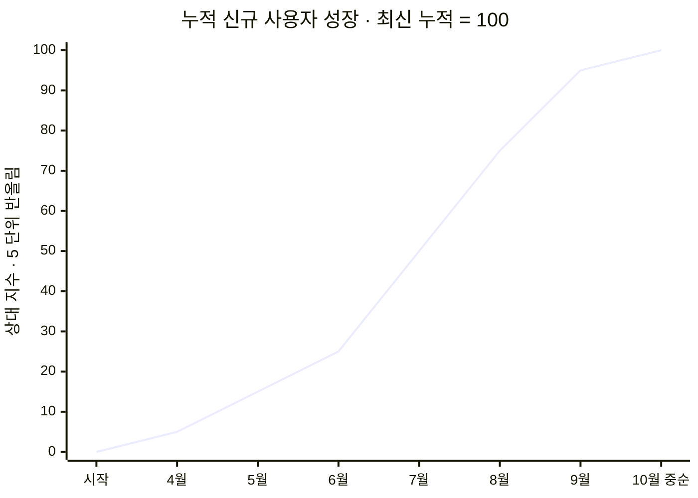
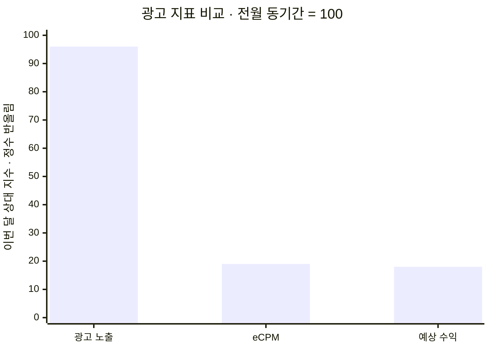

# 운영 기록 02 · 다운로드 증가와 광고 수익을 따로 읽기

> 2026-10-19 · 주식매매노트 운영 분석  
> 직접 확인한 Play Console 통계를 지난 광고 수익 분석과 연결했습니다. 정확한 설치 인원·수익 금액·원본 일별 수치 대신, 반올림한 상대 지수로 흐름만 공개합니다.

## 1. 다운로드가 늘고 있는데 왜 수익은 줄었을까?

지난 분석에서는 광고 노출이 크게 줄지 않았는데 수익이 하락한 이유를 살펴봤습니다. 이번에는 신규 설치 기록을 처음부터 다시 확인했습니다. 다운로드가 쌓이는 모습과 광고 수익이 줄어드는 모습이 동시에 나타날 수 있는지, 두 지표가 실제로 무엇을 의미하는지 확인하려는 작업이었습니다.

결론부터 말하면 **신규 이용자 유입은 계속됐지만, 이것이 같은 비율의 광고 수익 증가를 뜻하지는 않았습니다.** 누적 설치는 유입의 기록이고, 광고 수익은 실제 이용 중 발생한 광고 노출과 노출당 수익의 결과입니다.

## 2. 먼저 지표부터 맞췄다

Play Console의 신규 사용자 획득과 공식 누적값을 확인했습니다. 여기서 신규 사용자는 앱을 처음 설치한 사용자이며, 사전 설치 기기를 활성화한 경우도 포함합니다. 재설치·업데이트 횟수나 현재 설치 유지 인원, 일간 활성 사용자와는 구분했습니다.

- 전체 국가를 대상으로 최초 표시 기록부터 최신 집계일까지 확인
- 일별 원본과 공식 누적값을 따로 저장하고 교차 확인
- 집계되지 않은 최근 날짜를 다운로드 0으로 처리하지 않음
- 월 전체와 진행 중인 부분월을 그대로 비교하지 않음
- 공개용 그래프는 월 단위로 줄이고 지수를 거칠게 반올림

일별 표시값의 합과 공식 누적 사이에는 작은 차이가 있었습니다. 원인을 임의로 단정하지 않고 내부 자료에 차이를 남겼으며, 성장 그래프에는 공식 누적을 기준으로 사용했습니다. 최초 표시일을 실제 출시일로 단정하지도 않았습니다.

## 3. 누적 유입은 계속 증가했다

아래는 최신 누적을 100으로 놓고, 각 월말 누적을 **5 단위로 반올림**한 그래프입니다. 마지막 지점은 10월 중순까지의 부분 집계입니다. 실제 설치 인원이나 월별 다운로드 건수를 나타내는 그래프가 아닙니다.

시작의 0은 누적 출발점을 표현하기 위한 기준입니다. 매일의 측정값이 아니며, 점 사이 선도 일별 원본 추세를 표현하지 않습니다.

관찰한 흐름은 다음과 같습니다.

- 여름 구간에서 누적 증가 기울기가 비교적 가팔랐습니다.
- 이후에도 신규 설치는 이어졌지만 유입 속도는 일정하지 않았습니다.
- 최근 월초부터 중순까지를 전월 같은 날짜 구간과 비교하면 신규 유입은 약 10% 줄었습니다.
- 누적 그래프가 우상향한다는 사실만으로 최근 성장 속도가 빨라졌다고 판단하면 안 됩니다.

현재 자료로는 어떤 업데이트나 홍보가 유입을 만들었는지까지 확정할 수 없습니다. 그 판단에는 유입 경로와 배포 시점 등 추가 자료가 필요합니다.

## 4. 광고 수익은 다른 움직임을 보였다

[운영 기록 01](2026-10-16-ad-revenue-analysis.md)에서는 전월과 이번 달의 동일한 15일 구간을 비교했습니다. 전월 동기간을 각각 100으로 놓으면 이번 달의 노출량은 거의 유지됐지만 노출당 수익과 전체 수익은 크게 낮아졌습니다.

각 막대의 기준 100은 **해당 지표의 전월 값**입니다. 서로 다른 단위의 실제 수치를 비교하는 그래프가 아닙니다. 신규 설치 그래프와도 기준이 다르므로 두 그래프의 높이를 직접 비교하지 않습니다.

수익의 기본 관계는 다음과 같습니다.

**광고 수익 = 실제 광고 노출수 × eCPM ÷ 1,000**

eCPM은 광고 1,000회 노출당 수익입니다. 이번에 관찰한 큰 수익 하락은 노출 감소만으로 설명하기 어려웠고, 노출당 수익 하락이 핵심이었습니다.

## 5. 확인한 사실과 아직 남은 가설

| 구분 | 내용 |
|---|---|
| 확인 | 신규 설치는 계속 발생했고 누적 유입은 증가했습니다. |
| 확인 | 최근 같은 날짜 구간의 신규 유입 속도는 전월보다 다소 낮았습니다. |
| 확인 | 이전 광고 분석에서 노출량보다 eCPM 하락이 훨씬 컸습니다. |
| 확인 | 감소는 대부분 배너에서 나타났고, 주요 이용 국가 내부에서도 단가 하락이 남았습니다. |
| 가설 | 광고주 수요, 입찰 가격, 광고 구성 변화가 영향을 주었을 수 있습니다. |
| 미확인 | 재방문·체류·화면 배치 또는 특정 앱 버전이 얼마나 영향을 주었는지는 확인하지 못했습니다. |

새 사용자가 들어와도 기존 사용자가 덜 방문하면 전체 노출은 늘지 않을 수 있습니다. 하지만 이것은 가능한 설명이며, 이번 신규 설치 자료만으로 사용자 이탈이나 유지율 악화를 확인한 것은 아닙니다.

또한 한국 배너만 분리해도 단가 하락이 관찰됐으므로, 해외 저단가 이용자가 늘어서 생긴 현상만으로 설명하기는 어려웠습니다. 업데이트와 시점이 가깝다는 이유만으로 기능 변경을 원인으로 지목하지 않았습니다.

## 6. 앞으로 어떻게 관리할 것인가

이제 운영 지표를 다음 네 단계로 나눠 확인하려고 합니다.

1. 신규 유입은 동일한 날짜 구간으로 비교합니다.
2. 활성 사용자, 세션, 사용자당 광고 노출을 함께 봅니다.
3. 광고 단가는 국가와 광고 형식으로 나눠 추적합니다.
4. 버전별 변화는 실제 배포 시점과 연결해 확인합니다.
5. 광고 노출을 늘리는 변경은 사용 경험과 함께 판단하고, 효과가 검증되기 전에는 성과로 쓰지 않습니다.

이번에 얻은 운영상의 교훈은 **다운로드·이용·수익을 하나의 성장 지표로 묶지 않는 것**입니다. 누적 숫자가 올라가는지를 확인하는 데서 더 나아가, 실제 이용으로 이어지는지와 그 이용이 어떤 수익으로 연결되는지를 구분해서 관리하겠습니다.

## 자료와 공개 범위

- Play Console 조회일: 2026-10-19. 최근 신규 획득은 10월 중순까지 표시되어 미집계 기간을 제외했습니다.
- 광고 자료: 2026-10-16에 확인한 동일 앱의 AdMob Network 분석. 전월·이번 달의 동일한 15일 구간입니다.
- 두 자료의 최신 집계일은 다릅니다. 이번 글은 지표의 관계를 설명하는 기록이며, 동일 일별 표본의 상관관계나 인과관계를 검증한 분석은 아닙니다.
- 날짜는 서비스에 표시된 기준을 유지했습니다. 통계는 사후 보정될 수 있고 광고 수입은 예상값입니다.
- 원본 PDF·CSV, 실제 인원·금액·단가, 계정 및 광고 식별자, 앱의 핵심 코드는 공개하지 않습니다.
- 그래프에는 위에 표시한 반올림 지수만 포함했습니다. 원본 값을 이미지 메타데이터나 첨부 데이터로 제공하지 않습니다.

[운영 기록 목록](README.md) · [이전 광고 수익 분석](2026-10-16-ad-revenue-analysis.md)
