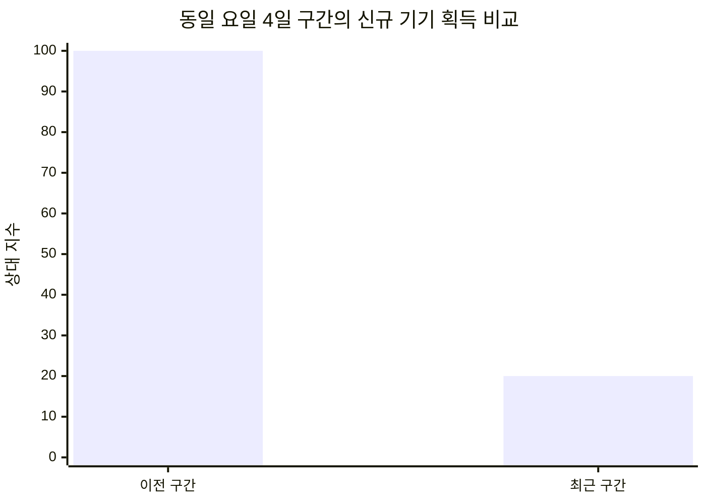

# 운영 기록 03 · 신규 설치가 급감했을 때 확인한 것

> 2026-10-22 기록 · 10월 21~22일에 확인한 Console 자료를 바탕으로 작성했습니다. 실제 설치·사용자 수와 수익 금액은 공개하지 않습니다. 아래 그래프는 원자료를 반올림한 상대 지수이며, 최신 구간은 집계 보정 가능성이 있습니다.

## 1. 누적 성장과 최근 유입을 따로 보기

주식매매노트를 운영하면서 누적 다운로드가 늘어나는 모습은 꾸준히 확인하고 있었습니다. 그런데 최근 며칠간 신규 설치가 크게 줄었습니다. 단순히 하루 수치만 보고 앱에 문제가 생겼다고 판단하지 않고, 제가 직접 지표 정의와 비교 기간부터 다시 확인했습니다.

이번에 본 지표는 **신규 기기 획득**입니다. 이전 운영 기록에서 다룬 신규 사용자 획득과는 단위가 다릅니다. 한 사람이 여러 기기를 사용할 수 있으므로 두 시계열을 그대로 이어 붙이지 않았습니다.

동일 요일로 구성된 연속 4일 구간을 비교했을 때, 최근 신규 기기 획득은 이전 구간 대비 **약 80% 감소**했습니다. 표본이 작은 단기 비교이므로 장기 추세로 확정하지 않았습니다.

이전 구간을 100으로 놓고 최근 구간을 10 단위로 반올림했습니다. 실제 설치 건수는 아닙니다. 표에 없는 날짜를 0으로 채우지 않았으며, 서비스 운영 이래 처음 발생한 저점인지도 이번 자료만으로 단정하지 않았습니다.

## 2. 유입 감소와 전환 저하를 나누어 확인

기존 스토어 등록정보 획득 화면에서 확인 가능한 날짜를 합산하면, Google Play 탐색 경로가 **약 95% 수준**을 차지했습니다. 공개 글에서는 비중도 거칠게 반올림했습니다. 이 지표의 모집단은 전체 신규 기기 설치와 다릅니다.

탐색 경로에 대한 의존도가 높으면 유입 구성이 바뀔 때 신규 설치도 흔들릴 수 있습니다. 다만 'Google Play 탐색'은 단일 추천 화면을 뜻하지 않습니다. 이 비중만으로 추천 알고리즘이 앱을 불리하게 취급했다고 결론 내리지는 않았습니다.

같은 요일의 두 날짜를 비교하면 스토어 방문자는 약 4분의 1 줄었지만, 획득은 약 80% 줄었습니다. 이 구간에서는 방문 감소보다 설치 전환 약화가 더 크게 보였습니다. 다만 최신 날짜 중 누락이 있고 표본이 작아 지속적인 전환 악화인지 추가 확인이 필요합니다.

### 서로 다른 화면의 수치를 바로 나누지 않은 이유

| 화면에서 본 신호 | 해석할 때 지킨 기준 |
|---|---|
| 최근 기기 노출·획득 요약은 감소 | 사용자 수와 기기 수를 구분 |
| 다른 스토어 화면의 방문·설치 클릭 요약은 증가 | 설치 버튼 클릭과 완료된 설치를 구분 |
| 최근 일별 행이 일부 표시되지 않음 | 미집계를 0으로 처리하지 않음 |
| 화면별 기간과 최신 날짜가 다름 | 동일 기간·동일 정의가 맞기 전에는 전환 퍼널로 계산하지 않음 |

즉, '클릭은 늘었는데 설치는 줄었으니 설치 실패가 원인'이라는 계산도 아직 할 수 없습니다. 현재 자료는 그 가능성을 점검할 이유를 제공할 뿐, 실패율을 증명하지 않습니다.

## 3. 업데이트·정책·품질을 대조한 결과

최근 배포와 설치 감소의 시점이 가까워 프로덕션 출시 상태, 게시 상태, 정책 화면, 품질 지표도 확인했습니다.

- 최신 버전은 전체 출시 상태였고 게시되지 않은 변경사항은 없었습니다.
- 조회 시점에 발견된 정책 문제는 표시되지 않았습니다.
- 기본 스토어 등록정보는 게시 중이었습니다.
- 최근 평균 평점은 이전 구간보다 좋아져, 평점 급락을 주원인으로 볼 근거는 없었습니다.
- 비정상 종료·ANR·느린 시작 항목에는 데이터가 없었습니다. 이를 오류율 0으로 해석하지 않았습니다.
- 최적화 및 플랫폼 대응 권고는 있었지만, 설치 감소와의 연관성은 확인되지 않았습니다.

배포 다음 날에도 신규 설치가 발생했으며 직전보다 높은 날이 있었습니다. 모든 설치가 업데이트 직후 막혔다는 설명과는 맞지 않습니다. 그렇다고 특정 기기 호환성이나 첫 실행 문제가 없다고 보장할 수도 없습니다. 버전별 지원 기기 변화와 실제 릴리스 앱의 첫 실행을 별도로 확인해야 합니다.

이 분석에서는 앱 코드, 배포 설정, 스토어 소개를 변경하지 않았습니다. 확인되지 않은 원인을 가정해 기능을 제거하는 대신, 문제가 생긴 구간부터 좁히는 쪽을 선택했습니다.

## 4. 동종 업계는 어떻게 비교했나

### Console 금융 카테고리 비교

확인한 최신 사용자층 성장률은 금융 카테고리의 상위 사분위 기준보다 높았습니다. 하지만 이것은 **4주 전 대비 설치 사용자층 변화**이며 최근 며칠의 신규 다운로드 증가율이 아닙니다. 금융 카테고리에는 은행·증권 등 여러 서비스가 섞여 있어 매매일지 앱 시장만의 지표도 아닙니다.

DAU/MAU는 날짜별 편차가 있었고 일부 날짜에는 카테고리 중앙값에 가까웠습니다. 비교 가능한 최신 구간이 설치 감소 구간보다 앞서 있어, 이를 최근 급감의 원인으로 연결하지 않았습니다.

### 직접 경쟁 제품의 공개 포지셔닝

| 앱 | 공개 소개에서 확인한 중심 가치 | 제 앱에서 점검할 부분 |
|---|---|---|
| [주식매매 거래 내역 기록](https://play.google.com/store/apps/details?id=com.lee.mystock&hl=ko) | 보유량·평단, 세금·수수료를 반영한 손익, 간단한 기록 | 입력 후 얻는 결과를 첫 화면에서 설명하는가 |
| [수익차곡](https://play.google.com/store/apps/details?id=com.chagok.app&hl=ko) | 다자산 기록, 손익 달력, 기록 습관, 위젯·CSV | 꾸준히 기록할 이유를 명확히 보여주는가 |
| [주식 매매일지 - 투자 기록 노트](https://play.google.com/store/apps/details?id=com.makertime.studio.stocknote) | 매수·매도 이유와 메모, 투자 복기 | 기존 메모·복기 기능이 소개에서 잘 드러나는가 |

경쟁 앱의 최근 일별 설치 수는 공개 자료로 확인할 수 없었습니다. 누적 다운로드 배지는 최근 성장률이 아니므로, 특정 경쟁 앱이 사용자를 가져갔다고 해석하지 않았습니다.

[주식매매노트](https://play.google.com/store/apps/details?id=com.thirteenthapp_stockmemo)의 메모·실현손익·PDF 기능은 이미 제공하는 가치입니다. 이 결과를 스토어 첫 스크린샷과 소개에서 더 분명히 보여주는 실험을 검토할 수 있습니다. 자동 시세 중심 서비스를 기대한 사용자와 기록·복기 중심 앱 사이의 기대 차이도 설명에서 줄일 후보입니다. 아직 효과를 검증한 개선 성과는 아닙니다.

## 5. 원인 가설과 다음 점검 순서

| 우선순위 | 가설 | 현재 근거와 한계 | 다음 확인 |
|---|---|---|---|
| 1 | 탐색 유입 구성 또는 전환 변화 | 탐색 의존도가 높고 일부 날짜의 방문·전환이 약화. 알고리즘 변경은 미확인 | 같은 요일을 포함한 7일 구간으로 경로별 방문·완료 설치 비교 |
| 2 | 집계 지연·불완전 자료 | 최신 및 중간 날짜의 누락 확인. 전체 감소를 이것만으로 설명할 수는 없음 | 같은 지표의 보정 후 수치 재확인 |
| 3 | 업데이트 관련 설치·첫 실행 문제 | 시점은 가깝지만 배포 직후에도 설치 발생 | 지원 기기·버전별 첫 실행·릴리스 앱 확인 |
| 4 | 스토어 소개와 검색 의도의 불일치 | 특정 검색어의 전환 개선 제안 존재. 최근 클릭 요약은 증가 | 첫 스크린샷 또는 설명 한 요소씩 실험 |
| 5 | 경쟁 격화·시장 수요 감소 | 직접 경쟁 앱의 최근 설치 자료 부재 | 공개 정보만으로 원인 확정하지 않기 |

여러 날 연속 낮아진 만큼 단순한 하루 변동으로 넘기지는 않겠습니다. 동시에 원인이 확인되기 전에 앱 전체를 바꾸지도 않겠습니다. **같은 기간의 방문 → 완료 설치 → 첫 실행을 맞춰 보는 것**이 먼저입니다.

## 6. 이전 광고 수익 분석과 연결해서 얻은 판단

[운영 기록 01](2026-10-16-ad-revenue-analysis.md)에서는 광고 수익 감소를 노출량과 광고 단가로 나누었고, [운영 기록 02](2026-10-19-growth-and-monetization.md)에서는 누적 유입 증가와 수익을 별도로 읽었습니다.

이전 광고 수익 감소에서는 eCPM 하락이 주요 신호였습니다. 이번 신규 설치 감소가 같은 원인이라는 증거는 없습니다. 신규 유입, 기존 사용자의 활동, 광고 노출, 광고 단가를 따로 추적해야 실제로 손댈 부분을 찾을 수 있습니다.

이번 기록의 결과는 원인을 하나로 확정한 것이 아니라, 확인한 사실과 아직 모르는 부분을 구분하고 점검 순서를 정한 것입니다. 개인 프로젝트를 운영하면서 코드 수정뿐 아니라 이런 판단 과정도 함께 기록하고 있습니다.

## 자료와 공개 범위

- 앱별 운영 지표: 제가 직접 확인한 Google Play Console 통계·스토어·벤치마크·품질·배포 화면.
- 지표 정의: [앱 통계 보기](https://support.google.com/googleplay/android-developer/answer/139628?hl=ko), [스토어 실적 분석](https://support.google.com/googleplay/android-developer/answer/9859173?hl=ko).
- 경쟁 제품 설명: 위 링크의 공개 Google Play 페이지. 표시 내용은 조회 시점에 따라 달라질 수 있습니다.
- 실제 건수, 수익 금액, 계정 식별자, 원본 내보내기, 개인 보관용 상세 PDF는 공개하지 않았습니다.
- 상대 지수와 변화율은 공개용으로 반올림했으며 정확한 원자료를 복원하는 용도로 사용할 수 없습니다.

[운영 기록 목록으로 돌아가기](README.md)
